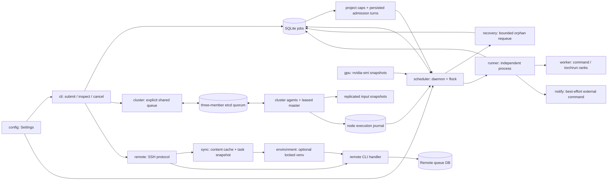

# 工程总览：从零上下文开始

这是开发者和 agent 的主入口。先读本页，再按任务进入模块说明，即可获得实现所需的
职责、接口、状态和验证背景。安装与使用见 [English README](../README.md) /
[中文 README](../README.zh-CN.md)；工程约束见 [AGENTS.md](../AGENTS.md)。

## 系统是什么

gpuq 是 Linux 上面向单个用户的机会式 GPU 队列，Python 3.10+，SQLite 持久化，
`nvidia-smi` 发现设备。支持单机单卡/多卡任务、显存学习、依赖和有界失联恢复。
它提供 SSH 远程 CLI、增量快照及可选 etcd 多数派控制的统一 GPU 池；不是 Slurm 或安全沙盒。
不同用户的队列互不协调，无法保证外部进程不在启动窗口抢显存。

默认提交是 auto 显存、1 张 GPU；`--gpu 0,1` 限定候选范围，`--gpus 2` 才申请两张。
配置默认每 10 秒采样，连续 3 个合格样本；`--memory`、`--reserve` 均为每卡 MB。
不要用总显存之和判断多卡任务是否可运行。

## 运行链路



1. 本地 CLI 验证参数后把 `Job` 写入本地 DB。指定 --remote 时先走 SSH，远程默认按内容增量
   接收代码、创建独立快照并准备可选环境，最后由远程 CLI 写远程 DB；查询/管理不经过同步。
   远程队列使用同一套 scheduler/runner 链路，提交本身不启动训练。
   --cluster 则先复制输入再写 etcd 全局队列，选出的主节点统一准入，节点持久去重后接入本地执行链路；
   失去多数派停止新授权，已有训练继续。有 quorum 时，失联任务默认在其他可运行工作清空或一小时后
   最多重排一次（可能重复训练）；回归节点取消被替代执行。部署与回切见[集群使用](cluster_usage.md)。
2. 每个状态目录一个 daemon，通过 `flock` 防止重复实例。每个 tick 最多启动一个任务，
   已启动任务可以并行。先核对失联进程、采样与峰值，再读取依赖满足的任务。
3. 调度器默认在普通任务间按项目活跃数/持久轮次公平排序；显式正优先级优先。按卡扣除队列未兑现预留。所有选中卡稳定合格并通过第二次
   采样后，在一次数据库领取中进入 `starting`；不会先占一部分卡等剩余卡。
4. daemon 启动独立 runner，写入 `running`。runner 再启动独立 worker 进程组，设置
   `CUDA_VISIBLE_DEVICES`，合并 stdout/stderr 到日志，等待命令退出并记录结果。
5. 识别到 GPU OOM 才学习并重排；普通错误失败。重启 daemon 保留仍活着的 runner/worker；
   两者失联时按配置恢复或记为 `failed/orphaned`。

## 状态和数据放在哪里

集群模式的权威元数据在 etcd；节点 work_dir 保存独立 SQLite 执行 journal、输入副本和缓存，
不会复制或合并普通队列 SQLite。见[集群模块](modules/cluster.md)。

默认状态目录 `~/.local/state/gpuq` 内有 `queue.sqlite3`、`logs/`、`gpuqd.lock`；
默认配置 `~/.config/gpuq/config.toml`。数据库是任务事实来源，内存中稳定窗口不是持久状态。
路径优先级及一个环境变量例外见 [配置](modules/config.md)。
项目上限/轮次保存在同库 projects/scheduling_state，重启保留；普通任务默认每项目 1 个。
远程持久根默认为 ~/.local/share/gpuq/workspaces，包含 job-* 快照、blobs、environments、cache，
与队列状态目录分离；没有自动清理或产物回传，见 [同步](modules/sync.md) 和 [环境](modules/environment.md)。

| 状态 | 含义与负责模块 |
|---|---|
| `queued` / `waiting_memory` / `retry_wait` | 待调度；db 检查依赖，scheduler 检查资源 |
| `assigned`（仅集群） | 全局分配到节点，尚未被执行节点接受；同样计入占用 |
| `starting` | db 原子领取完成、整组 GPU 已记录，等待 runner 就绪 |
| `running` | runner 已启动；worker PID 可能尚未登记 |
| `completed` / `failed` / `cancelled` | 终态；runner 或管理路径写入 |
| `blocked_dependency` | 父任务失败/取消/依赖阻塞，db 在读取 runnable 时传播 |

`pid`/`pgid` 是 runner，`worker_pid` 是实际命令及其进程组首领。
`assigned_gpu` 是兼容旧客户端的第一张卡，`assigned_gpus` 才是完整分配。
完整字段和转换条件分别见 [模型](modules/models.md) 与 [数据库](modules/db.md)。

## 模块导航

每份说明先给出契约，再列出源码定位和验证入口；不需要先打开链接中的 `.py`。

| 模块说明 | 覆盖范围 / 应解决的问题 |
|---|---|
| [Agent 操作技能](modules/agent-skill.md) | 面向使用者的 gpuq 技能、安装、队列选择与按需参考 |
| [入口](modules/entrypoints.md) | `__init__`、`__main__`、打包入口；Python/二进制怎样调用 CLI 与 runner |
| [全局队列与选主](modules/cluster.md) | 多数派控制面、首选主回归、执行去重与节点隔离 |
| [集群输入复制](modules/cluster-transfer.md) | 复制输入缓存与读取节点日志；不在传输时提交任务 |
| [集群一致性适配](modules/coordination.md) | etcd 线性读取、事务、租约与失败隔离 |
| [远程 SSH](modules/remote.md) | 请求协议、统一远程调用与失败边界 |
| [增量同步](modules/sync.md) | 内容缓存、排除规则、独立代码快照 |
| [远程环境](modules/environment.md) | 依赖锁文件、远程 venv 与模型缓存边界 |
| [项目识别](modules/projects.md) | 自动根目录识别、稳定项目身份 |
| [CLI](modules/cli.md) | 命令解析、展示、日志、doctor、命令行覆盖和退出码 |
| [配置](modules/config.md) | 全部 Settings 默认值、环境变量、路径、配置传播 |
| [模型](modules/models.md) | Job/GPU 数据契约、单位、JSON 兼容和状态集合 |
| [数据库](modules/db.md) | schema、迁移、领取事务、状态更新与清理规则 |
| [GPU 发现](modules/gpu.md) | backend 协议、CSV 解析和采样异常 |
| [调度器](modules/scheduler.md) | 选卡、稳定窗口、预留、进程检测、daemon 和取消 |
| [执行器](modules/runner.md) | 实际命令环境、进程组、日志、OOM 和结果写回 |
| [失联恢复](modules/recovery.md) | 独立重试预算、恢复审计和 checkpoint 边界 |
| [通知](modules/notify.md) | 模板 argv、外部通知进程、失败隔离 |
| [测试](modules/testing.md) | 每个测试文件、fixtures、模拟进程和针对性命令 |
| [构建与运维](modules/operations.md) | pyproject、CI/release、systemd、示例配置、仓库元数据 |
| [文档设施](modules/documentation.md) | 清单、模板、自动检查和文档维护流程 |

精确文件归属是 [module-map.json](module-map.json)，自动检查以实际 Git 工作区文件清单为准。

## 按任务找修改点

| 要做什么 | 先读的模块 | 必须一起考虑 |
|---|---|---|
| 修改 agent 使用流程 | [操作技能](modules/agent-skill.md)、[CLI](modules/cli.md) | 双语 README 安装入口、参考文件、参数/故障语义 |
| 修改全局调度/选主/回切 | [集群](modules/cluster.md)、[一致性](modules/coordination.md)、[复制](modules/cluster-transfer.md) | 任期隔离、持久执行去重、三成员测试、双语部署手册 |
| 修改远程提交、传输或环境 | [SSH](modules/remote.md)、[同步](modules/sync.md)、[环境](modules/environment.md) | 协议兼容、隔离快照、缓存复用、双语远程手册 |
| 修改项目公平性 | [项目识别](modules/projects.md)、[调度器](modules/scheduler.md) | DB 持久轮次、并发限额、优先级、无抢占 |
| 新增提交参数或 JSON 字段 | [CLI](modules/cli.md)、[模型](modules/models.md) | db 持久化/迁移；远程转发；用户双语 CLI 手册；CLI 与 DB 测试 |
| 修改选卡、独占或显存策略 | [调度器](modules/scheduler.md)、[GPU](modules/gpu.md) | 第二次检查、队列预留、固定/auto、多卡、两种外部共享策略 |
| 修改 OOM 或 retry 行为 | [执行器](modules/runner.md)、[数据库](modules/db.md) | 普通失败隔离、auto 无次数上限、fixed 有界、整组释放 |
| 添加配置项 | [配置](modules/config.md)、[CLI](modules/cli.md) | Settings 加载、CLI 重建 Settings、样例配置、runner 继承环境 |
| 改 schema/状态机 | [数据库](modules/db.md)、[模型](modules/models.md) | 老 DB 迁移、每个清理路径、恢复事务、终态竞争 |
| 修复重启、取消、进程残留 | [调度器](modules/scheduler.md)、[恢复](modules/recovery.md)、[执行器](modules/runner.md) | runner/worker 不同组，独立 session rank 由启动器转发信号，systemd 语义 |
| 修改分布式/多卡支持 | [调度器](modules/scheduler.md)、[执行器](modules/runner.md) | per-card 计量、完整 assigned_gpus、torchrun 后代识别、旧单卡兼容 |
| 发布或改安装方式 | [运维](modules/operations.md)、[入口](modules/entrypoints.md) | 版本/tag/notes 一致、内部 runner、二进制 smoke test |
| 新增文件或改文档组织 | [文档设施](modules/documentation.md) | 更新归属、主入口、双向导航、链接与语义核验 |

## 无 GPU 的开发与验证

在仓库根目录，使用隔离的 Python 环境：

```bash
python -m venv .venv
. .venv/bin/activate
python -m pip install -e '.[dev]'
python scripts/check_docs.py
ruff check src tests scripts/check_docs.py
pytest
python -m build
```

测试不要求 GPU，但有真实 CPU 子进程、信号和 `/proc` 测试，运行环境应为 Linux。
`doctor` 和正常 daemon 需要 NVIDIA 环境；它们不是无 GPU 测试替代品。
测试或文档检查通过不等于验证了真实 CUDA 多卡训练。不要操作用户真实状态目录做验证。

## 阅读边界与已知易错点

- `daemon --dry-run` 只禁止领取/启动，并非数据库只读：失联核对、峰值、依赖和
  不可能显存判定仍可能更新状态。用临时队列做诊断实验。
- 纯 `Job` 对象是快照；进程/取消状态需要重新从 db 读取。`active()` 扫描全部活跃任务。
- daemon 的命令行覆盖使用 dataclasses.replace 保留未覆盖配置。
- 日志按多次尝试追加；OOM 当前根据末尾 128 KiB 文本识别，旧尝试文本仍可能在尾部。
- 当前版本为 `0.3.0`，源码、包元数据和二进制下载示例保持一致。
- 新记录和执行器日志写 UTC；show 文本/JSON 与 list JSON 按 CLI 所在主机本地时区显示并带 offset。
  旧记录按自身 offset 解读，不自动改写；logs 不重写已有日志文本。

这些是当前实现限制，不是工程承诺。具体上下文和测试覆盖缺口见相应模块。

## 其他文档与验收

集群部署：[中文](cluster_usage.md) / [English](cluster_usage.en.md)。
远程使用：[中文](remote_usage.md) / [English](remote_usage.en.md)。
用户参数：[中文](cli_reference.md) / [English](cli_reference.en.md)。
调度语义：[中文](scheduling.md) / [English](scheduling.en.md)。
用户恢复说明：[失联恢复](orphan_recovery.md)。
协作：[CONTRIBUTING](../CONTRIBUTING.md)、[SECURITY](../SECURITY.md)、[CHANGELOG](../CHANGELOG.md)。
新增模块：[模板](templates/module.md)。

零上下文验收：仅沿本页和模块说明，应能解释从 submit 到完成/重试的数据流，指出新增
字段涉及的文件，说明多卡分配和取消的安全边界，给出正确测试命令并区分已测与未测能力。
若仍需读源码才能回答这些基础问题，先补文档再视为完成。
